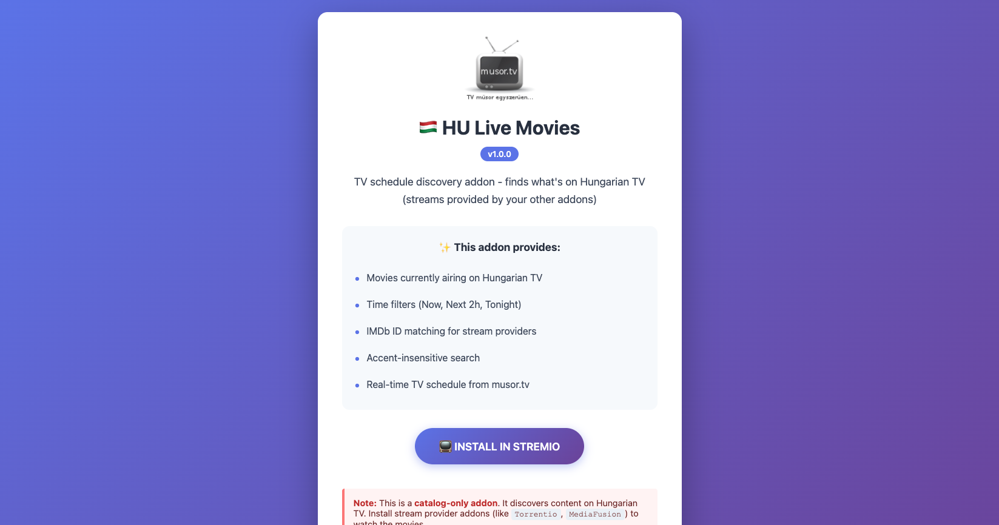
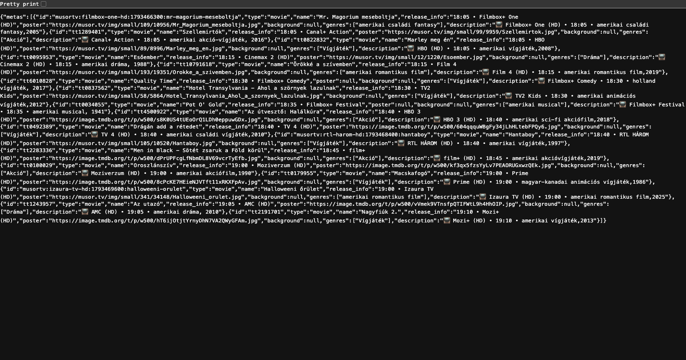
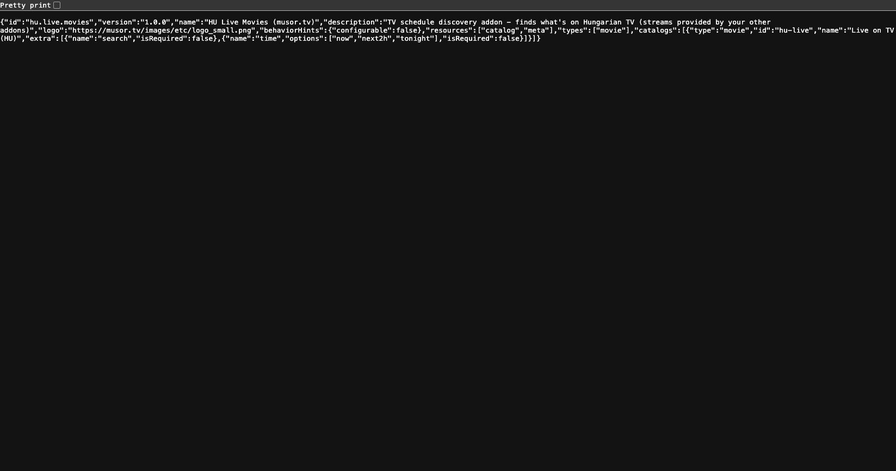

# HU Live Movies for Stremio

[](https://github.com/radamhu/stremio-musor_tv/actions/workflows/ci.yml)
[](https://github.com/radamhu/stremio-musor_tv/pkgs/container/stremio-musor-tv)
[](https://www.python.org/downloads/)
[](https://fastapi.tiangolo.com/)
[](#license)

A catalog-only [Stremio](https://www.stremio.com/) addon that shows which movies are airing on Hungarian TV. It reads live listings from [musor.tv](https://musor.tv) and matches titles to IMDb ids, so stream addons such as Torrentio or MediaFusion can pick them up.

It is not a streaming provider and serves no video.

<p align="center">
  
</p>

<table>
  <tr>
    <td width="50%"></td>
    <td width="50%"></td>
  </tr>
  <tr>
    <td align="center"><sub>Catalog (<code>?time=tonight</code>)</sub></td>
    <td align="center"><sub>Manifest</sub></td>
  </tr>
</table>

<sub>Screenshots captured from the live deployment at <code>https://stremio-musor-tv-latest.onrender.com</code>.</sub>

## Table of contents

- [Features](#features)
- [Install](#install)
- [How it works](#how-it-works)
- [Run it yourself](#run-it-yourself)
- [Configuration](#configuration)
- [API](#api)
- [Testing](#testing)
- [Documentation](#documentation)
- [Contributing](#contributing)
- [Roadmap](#roadmap)
- [License](#license)

## Features

- Movies airing now, in the next 2 hours, or tonight
- Accent-insensitive Hungarian search (`matrix` finds `Mátrix`)
- IMDb ids via TMDB (optional), so stream addons recognise the titles
- Poster, channel, start time and genre on every entry
- Stateless, about 62 MB RAM, no browser runtime
- Degrades to empty or partial results if musor.tv or TMDB is down

## Install

Use the hosted instance or your own deployment.

1. Open Stremio, go to Addons, then Community Addons.
2. Paste the manifest URL and install:
   ```
   https://stremio-musor-tv-latest.onrender.com/manifest.json
   ```
3. Browse Movies, open the **Live on TV (HU)** catalog.
4. Install a stream addon (Torrentio, MediaFusion, Comet) to play what you find.

The free Render instance sleeps when idle; the first request can take around a minute.

## How it works

```
Stremio ──► this addon (catalog + meta) ──► IMDb id ──► your stream addons ──► playback
                 │
                 └── musor.tv (scrape) + TMDB (id lookup, optional)
```

- Titles matched to IMDb get their `tt…` id. Others get `musortv:{channel}:{timestamp}:{slug}`, which is visible but not resolvable by stream addons.
- About 75 % of international films match; Hungarian titles often do not.
- Schedule maths uses `Europe/Budapest`, including midnight rollover.

Architecture and internals: [docs/DEVELOPMENT.md](docs/DEVELOPMENT.md).

## Run it yourself

Requires Python 3.11+ or Docker. About 256 MB RAM.

### Docker

```bash
cp .env.example .env
docker compose up --build -d
```

Or use the published image:

```bash
docker run -d -p 7000:7000 -e TZ=Europe/Budapest ghcr.io/radamhu/stremio-musor-tv:latest
```

### Python

```bash
pip install -r requirements.txt
cp .env.example .env
cd src && python main.py
```

The addon is at `http://localhost:7000/manifest.json`.

### Render

`render.yaml` is a Docker-runtime blueprint. Connect the repository to Render, set `TMDB_API_KEY` as a secret, deploy.

## Configuration

Environment variables only. `.env` is for local development.

| Variable | Description | Default |
| --- | --- | --- |
| `TZ` | Must be `Europe/Budapest` | none (required) |
| `PORT` | HTTP port | `7000` |
| `LOG_LEVEL` | `debug`, `info`, `warning`, `error` | `info` |
| `CACHE_TTL_MIN` | Catalog cache TTL in minutes | `10` |
| `SCRAPE_RATE_MS` | Minimum ms between scrapes | `30000` |
| `TMDB_API_KEY` | TMDB v3 key or Bearer token; enables IMDb ids | unset |
| `IMDB_LOOKUP_ENABLED` | Toggle IMDb lookup | `true` |
| `IMDB_CACHE_TTL_DAYS` | IMDb cache TTL in days | `7` |
| `IMDB_RATE_LIMIT_PER_SEC` | Max TMDB requests per second | `40` |
| `DISCORD_WEBHOOK_URL` | Optional runtime webhook | unset |

A free TMDB key comes from <https://www.themoviedb.org/settings/api>. The addon works without one, but stream addons will not match titles.

## API

| Endpoint | Purpose |
| --- | --- |
| `GET /manifest.json` | Addon manifest |
| `GET /catalog/movie/hu-live.json` | Movie catalog |
| `GET /meta/movie/{id}.json` | Details for an IMDb or `musortv:` id |
| `GET /healthz` | Scraper and IMDb status |
| `GET /` | Landing page with install link |

Catalog query parameters (also accepted as Stremio extra path segments):

| Parameter | Values |
| --- | --- |
| `time` | `now` (default, next 90 min), `next2h`, `tonight` (18:00 to 23:59) |
| `search` | Title filter, accent-insensitive |

```bash
curl "http://localhost:7000/catalog/movie/hu-live.json?time=tonight&search=matrix"
```

```json
{
  "metas": [
    {
      "id": "tt0133093",
      "type": "movie",
      "name": "Mátrix",
      "release_info": "21:00 • RTL",
      "poster": "https://musor.tv/img/small/...",
      "genres": ["Akció"],
      "description": "📺 RTL • 21:00 • amerikai sci-fi akciófilm,1999"
    }
  ]
}
```

```bash
curl http://localhost:7000/meta/movie/tt0133093.json
```

Responses are a public contract; changes are additive unless documented otherwise. The manifest declares only `catalog` and `meta`.

## Testing

```bash
pip install -r requirements.txt
python -m pytest tests/ -q --ignore=tests/test_stream_support.py --ignore=tests/test_stream_endpoint.py
```

Tests run offline against HTML fixtures and mocks. More commands and coverage areas: [docs/DEVELOPMENT.md](docs/DEVELOPMENT.md#local-setup-and-tests).

## Documentation

| Document | Content |
| --- | --- |
| [docs/DEVELOPMENT.md](docs/DEVELOPMENT.md) | Architecture, scraper and selectors, fixtures, CI/CD, migration notes, troubleshooting |
| [AGENTS.md](AGENTS.md) | Repo invariants for humans and AI agents |
| [SKILL.md](SKILL.md) | Recurring repo workflows |

## Contributing

1. Fork, branch, make the change with tests.
2. Run the test suite above.
3. Open a pull request. Read [AGENTS.md](AGENTS.md) first: catalog-only scope, no new datastore or framework without an ADR, no silent contract changes.

Scraper selector breakage is the most common issue; see [fixture maintenance](docs/DEVELOPMENT.md#parser-fixture-maintenance).

## Roadmap

- [ ] Extra TMDB metadata (ratings, cast, plot)
- [ ] Year extraction from more category formats
- [ ] Manual IMDb id overrides
- [ ] Series support
- [ ] More time presets (weekend, week ahead)
- [ ] English interface option

## License

[MIT](https://opensource.org/licenses/MIT), copyright (c) 2025 radamhu.

Built on FastAPI (MIT), httpx (BSD), selectolax (MIT), Pydantic (MIT), Uvicorn (BSD), aiohttp (Apache 2.0). Listings courtesy of [musor.tv](https://musor.tv); not affiliated with Stremio or musor.tv.
